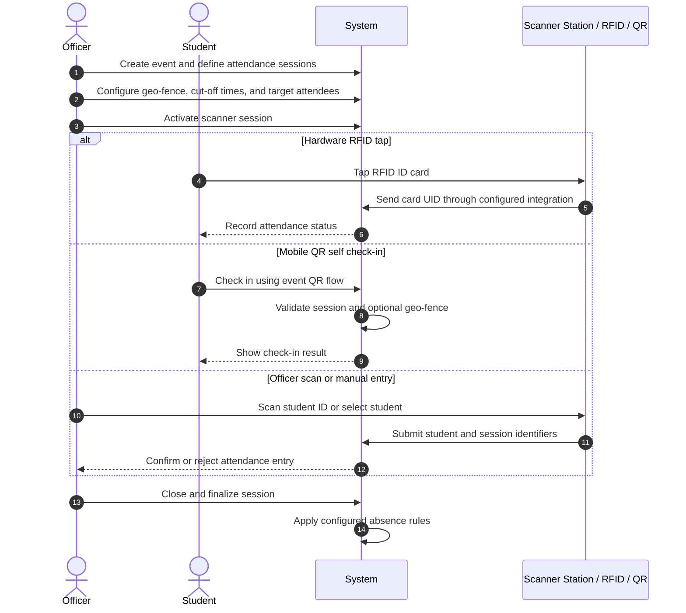
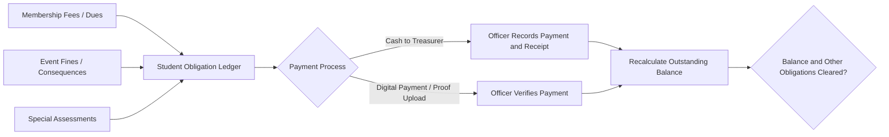
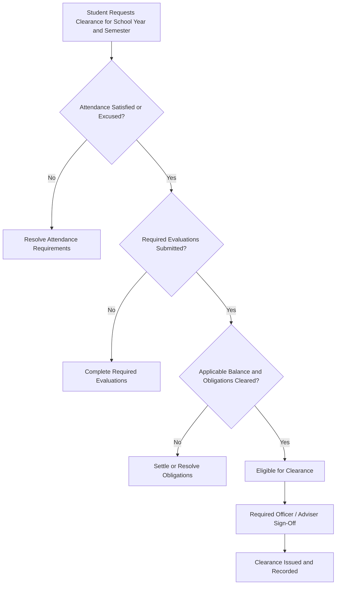

# Tapasok — Student Organization Management System
## Full System Structure and Functional Requirements

## Purpose
Tapasok manages institutional academic configuration, student accounts, organization membership, events, attendance, evaluations, consequences, finances, clearance, and organizational communication.

This document describes the intended workflow and modules. Implement features with role-based access control, secure data handling, and organization-level data isolation.

---

# Phase 1: Setup and Institutional Configuration

## 1.1 Academic Structure Setup
System administrators configure the institution's academic structure:

- Set the active **School Year**.
- Set the active **Semester**.
- Configure **Colleges**.
- Configure **Departments** under colleges.
- Configure **Degree Programs / Courses** under departments.
- Maintain relationships between school years, semesters, colleges, departments, and programs.
- Allow authorized administrators to update academic configuration without breaking existing student or historical records.

The system should support selecting a school year and semester wherever academic context is relevant, including events, membership, financial assessments, reports, and student clearance.

## 1.2 Organization Creation
System administrators can create and maintain student organizations. Organizations may be:
- Departmental
- College-wide
- University-wide
- Co-curricular or interest-based

Each organization should have an assigned official **Faculty/Staff Adviser**. Store the organization's scope and, where applicable, its linked college, department, or program.

## 1.3 User Account Registration and Student Profiles
Students, officers, advisers, and administrators can be registered manually or imported in bulk through CSV.

Student profiles should support:
- Student ID number
- Program / course
- College and department
- Year level
- Contact information
- RFID card UID
- Profile photo
- Address information, where required

### Academic placement
- Link a student's program/course to the configured institutional academic structure.
- Store year level as a structured value where practical.
- Support tracking enrollment by school year and semester when needed.
- Preserve historical academic information for past memberships, attendance, reports, and clearance.

### Philippine address reference data
Use the provided Philippine Standard Geographic Code API:
- API: https://psgc.gitlab.io/api/
- Use it for relevant region, province, city/municipality, and barangay selections.
- Verify actual endpoints and response formats against the API documentation before implementation.
- Use dependent, validated location selections where practical.
- Handle loading and API failures gracefully.
- Do not send student personal information to the PSGC API.

### CSV import safety
- Validate required columns and data formats.
- Detect duplicate student IDs and email addresses.
- Show row-level validation errors and an import summary.
- Never assign elevated permissions automatically through student import.
- Do not invent or expose passwords; use a secure account activation or password setup flow if accounts are created.
- Avoid duplicate imports and unintended overwrites.

---

# Phase 2: Organization Membership and Officer Designations

## 2.1 Joining an Organization
Support two membership pathways.

### Automatic academic organization mapping
Students enrolled in a specific department, college, or program may be mapped to a corresponding academic organization when a valid mapping is configured.
- Only apply automatic mapping when the academic-unit-to-organization relationship is explicitly configured.
- Prevent duplicate memberships.
- Record the applicable school year and semester where membership is term-based.
- Do not automatically enroll students into unrelated interest-based organizations.

### Manual join request
For co-curricular and interest-based organizations:
1. A student finds an organization and submits a join request.
2. Authorized organization officers review the request.
3. The request is approved or rejected.
4. The system records the decision and timestamp.
5. The student can see the request status.

## 2.2 Officer Roles and Operational Privileges
Organization leadership can designate official positions such as President, Secretary, Treasurer, Auditor, and other institution-approved positions.

Operational permissions should be tied to authorized capabilities, not merely the position's display name.
- Treasurer: manage permitted fees, payments, and financial records.
- Secretary: manage permitted attendance records, meeting minutes, and organizational documentation.
- President: oversee organization operations and authorized officer assignments.
- Adviser: review and approve actions requiring adviser oversight.

Users may hold different roles in different organizations. Organization roles must remain separate from system-level administrator privileges. Enforce least-privilege access on the server.

---

# Phase 3: Event and Attendance Lifecycle

## 3.1 Event Scheduling
Authorized officers can draft and manage events with:
- Title
- Description
- Date and time
- Venue
- Geolocation coordinates and geo-fence radius, if enabled
- Target attendees
- Applicable school year and semester
- Attendance sessions
- Cut-off times and grace periods
- Applicable attendance and consequence rules

Support configurable sessions such as Morning Time-In, Morning Time-Out, Afternoon Time-In, and Afternoon Time-Out.

## 3.2 Attendance Capture Methods

### Method A: Hardware RFID tap
1. A student taps their physical ID card at a compatible terminal.
2. The terminal sends the card UID through a configured integration.
3. The system matches the UID to a student record.
4. The system records attendance and determines the status (for example, Present or Late) using configured rules.

Hardware support requires a defined device integration; do not pretend hardware is connected when it is not.

### Method B: Mobile QR self check-in
1. The student opens or scans the event QR check-in flow.
2. The system validates the event, session, eligibility, and check-in window.
3. If geo-fencing is enabled, the system requests location permission and checks whether the reported location is within the configured venue radius.
4. The system records the check-in result.

Handle denied location permission, inaccurate GPS readings, expired sessions, and duplicate check-ins with clear messages. Browser GPS is not tamper-proof.

### Method C: Officer scanner or manual entry
1. An authorized officer opens the correct event session.
2. The officer scans a student ID barcode/QR or selects a student through a permitted manual workflow.
3. The system validates eligibility and the session window.
4. The system records the attendance entry and the operator.

## 3.3 Session Closing and Absences
- Authorized officers can close an attendance session.
- When a session is finalized, students expected for that session without a valid attendance record may be marked Absent according to configured rules.
- Support authorized excused absences and corrections with an audit trail.
- Do not mark students absent if they were not in the target attendee list or were exempt under configured rules.
- Prevent duplicate attendance entries and preserve who made manual changes.

## 3.4 Attendance Lifecycle

---

# Phase 4: Post-Event Evaluation

## 4.1 Evaluation Form Creation
Authorized officers can create event evaluation questionnaires with:
- Rating scales
- Likert scales
- Multiple choice
- Written comments

Forms should support validation, publication status, and association with the correct event and academic term.

## 4.2 Survey Submission
- Eligible students receive an in-app prompt or notification to evaluate an event.
- The system tracks required evaluation submissions.
- If evaluation submission is a clearance requirement, enforce it through the clearance workflow.
- Make the evaluation requirement configurable per event.

## 4.3 Evaluation Analytics
Provide authorized officers and advisers with:
- Response counts and response rates
- Average rating scores where applicable
- Satisfaction summaries
- Aggregated feedback and comments

Limit access to identifiable responses according to permissions. Use aggregated reporting where individual-level details are unnecessary.

---

# Phase 5: Consequence Rules, Absences, and Sanctions

## 5.1 Rule Configuration
Authorized organization personnel can configure consequence rules for applicable event types or sessions.

Examples:
- Missing one session may incur a ₱50 fine or two hours of community service.
- An unexcused whole-day absence may incur a ₱100 fine.

These are examples, not universal defaults. Organizations must configure and authorize their actual rules.

## 5.2 Automated Consequence Calculation
When attendance is finalized:
1. Evaluate finalized attendance records against the applicable consequence rules.
2. Identify eligible Absent or Late records.
3. Exclude excused absences and other exemptions.
4. Create the pending fine, service obligation, or other configured consequence.
5. Record the source event/session, rule applied, amount or service hours, and calculation timestamp.
6. Prevent duplicate consequences when a session is finalized or recalculated.

Consequences should be reviewable and correctable by authorized personnel with an audit trail.

---

# Phase 6: Finance and Obligation Ledger

## 6.1 Fee Assessment
Authorized finance personnel can assess:
- Organization membership dues
- Semester fees
- Event-specific contributions
- Special assessments
- Approved fines and other consequences

Associate assessments with the relevant organization and, where applicable, school year, semester, event, and student.

## 6.2 Student Obligation Ledger
Maintain a ledger summarizing each student's obligations for the relevant organization and term:
- Membership dues
- Event fines or absence consequences
- Special assessments
- Community service hours or other non-monetary obligations

Track assessed amount, payments, adjustments, outstanding balance, status, and history. Do not silently delete or rewrite financial history.

## 6.3 Payment and Verification

### Cash payment
1. The student pays an authorized treasurer or finance officer.
2. The officer records the payment.
3. The system generates a unique receipt or reference code.
4. The ledger balance is updated.

### Digital payment and proof upload
1. The student submits the payment reference and permitted proof.
2. An authorized officer reviews the submission.
3. The officer confirms or rejects it with a recorded reason where appropriate.
4. Confirmed payments update the ledger balance.

- Do not mark digital payments as paid merely because proof was uploaded.
- Restrict access to payment evidence and financial records.
- Maintain an audit trail for payments, refunds, adjustments, and verification decisions.

---

# Phase 7: Semester Student Clearance

## 7.1 Clearance Request and Verification
Students can request clearance for the relevant school year and semester, subject to the institution's configured rules.

The system checks:
1. Whether required attendance obligations are satisfied or absences are excused.
2. Whether all required event evaluations have been submitted.
3. Whether applicable financial obligations have been settled.
4. Whether other configured clearance requirements are satisfied.

Show the student which requirements remain incomplete and how to resolve them.

## 7.2 Sign-Off
- Once automated checks pass, the student becomes Eligible for Clearance.
- Designated organization officers and faculty advisers provide required sign-off.
- Record each sign-off, signer's identity and role, timestamp, and relevant notes.
- After all required approvals, issue an official digital clearance record or status.
- Preserve clearance history by school year and semester.

Do not represent clearance as approved before all required checks and sign-offs are complete.

---

# Phase 8: Communication and Governance

## 8.1 Announcements
Authorized officers can publish announcements targeted by permitted criteria:
- Organization
- College
- Department
- Program / course
- Year level
- Relevant school year and semester

Support in-app notifications. Push notifications may be added where the application has a configured and tested provider. Do not claim push delivery is available without that integration.

## 8.2 Minutes and Archives
Provide secure storage for:
- Meeting minutes
- Attendance sheets
- Resolutions
- Event documents
- Other organization records

Support access control, academic-term association where relevant, and audit visibility for authorized advisers and administrators.

## 8.3 Direct and Group Communication
Support appropriate direct or group communication between authorized officers, advisers, and members, limited to the relevant organization and permitted participants.

---

# Cross-Cutting Requirements

## Academic Context: School Year, Semester, and Program/Course
School year, semester, college, department, program/course, and year level are core institutional data—not optional free-text labels where structured references are practical.

- Provide administrator screens for managing school years, semesters, colleges, departments, and programs/courses.
- Allow administrators to select the active school year and semester.
- Associate events, memberships, assessments, evaluations, reports, and clearance with the applicable academic term where relevant.
- Preserve historical records when the active term changes.
- Validate that a selected program belongs to the selected department and college.
- Do not assume a student's current program or year level was the same in previous semesters.

## Security and Permissions
- Enforce role and organization-level authorization on the server.
- Keep system administrator privileges separate from organization roles.
- Limit users to organizations and records they are authorized to access.
- Use least privilege, audit important actions, and protect student, attendance, financial, and uploaded data.
- Never grant elevated roles through CSV import or automatic academic membership mapping.
- Keep sensitive information out of logs and external API requests.

## Reliability and User Experience
- Provide responsive pages, consistent navigation, validation, loading states, empty states, and useful error messages.
- Prevent duplicate memberships, attendance records, payments, and consequences.
- Use database transactions where related operations must succeed or fail together.
- Test permissions, academic relationships, attendance finalization, financial calculations, and clearance rules.
- Use safe, reviewed database migrations and preserve existing data.

## Implementation Guidance
Before changing the application, inspect the existing specification, codebase, database schema, and current functionality. Reuse working components and conventions. Implement features in practical stages, test actual behavior, and report what is complete, what failed, and what still requires real hardware or external-service configuration.
